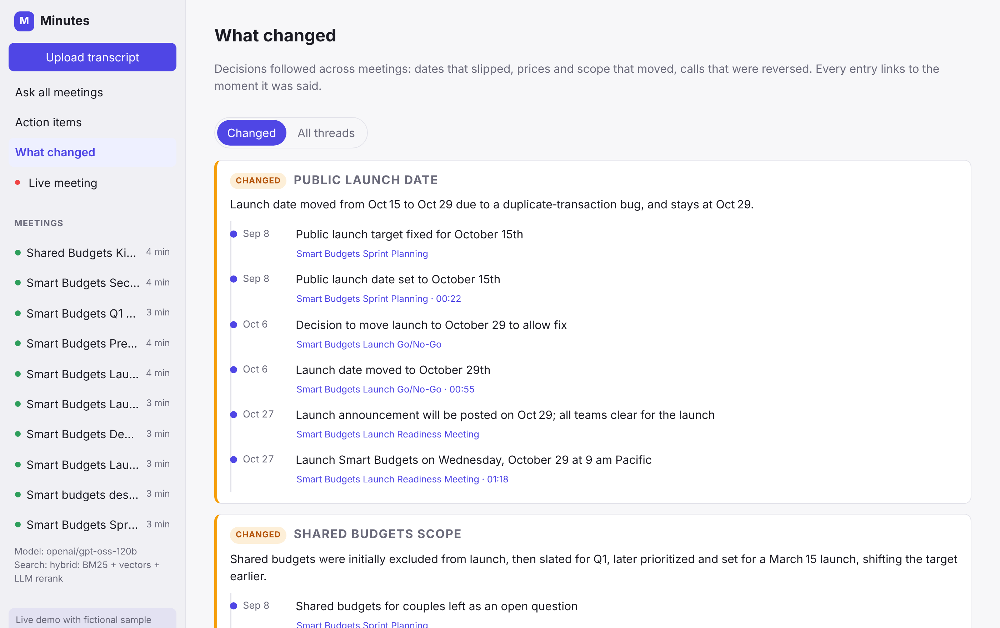
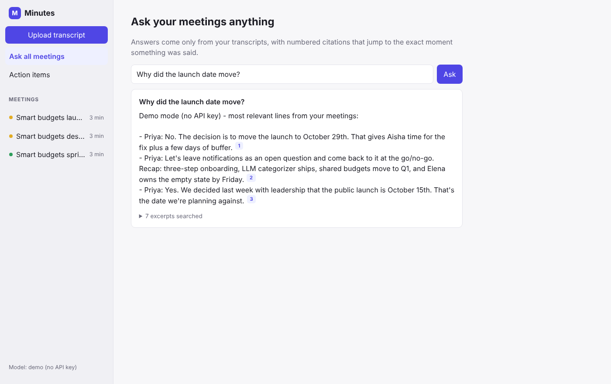
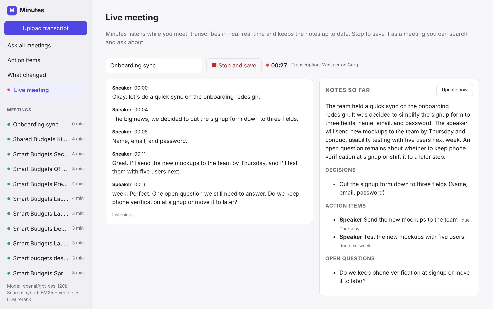
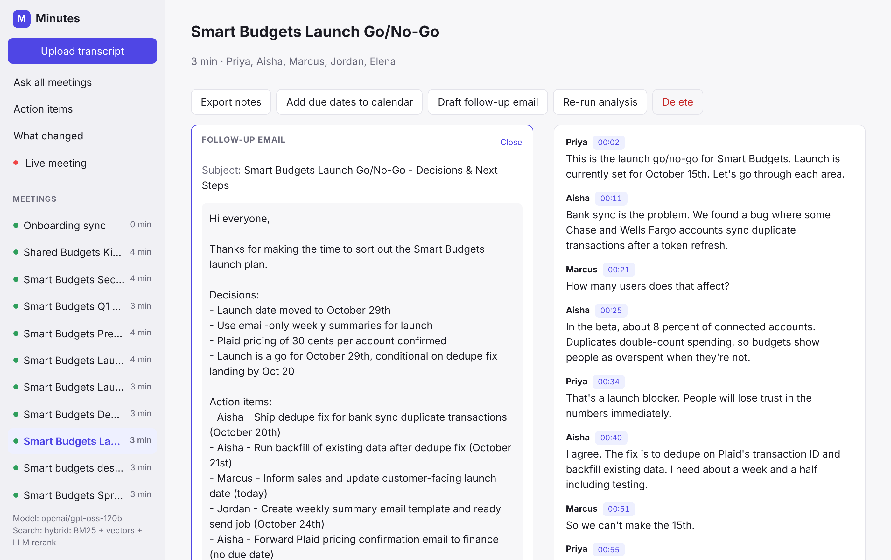
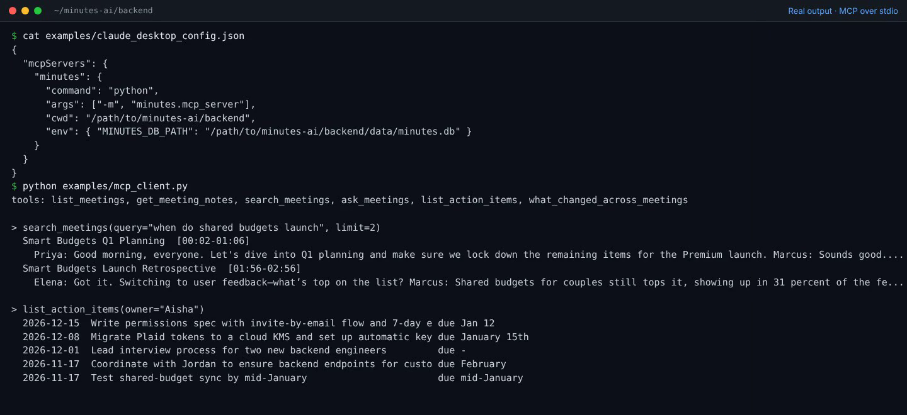
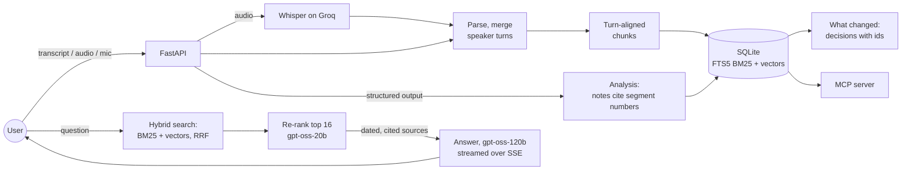

<h1 align="center">Minutes</h1>

<p align="center"><b>An AI meeting copilot: notes linked to the exact moment, cited answers across every meeting, a timeline of what changed, live transcription, and an MCP server so your AI tools can use your meetings too.</b></p>

<p align="center">
  Python · FastAPI · SQLite FTS5 + vectors · Groq (gpt-oss, Whisper) · Claude / Gemini · MCP · React + TypeScript · Vercel · Docker · GitHub Actions
</p>

<p align="center">
  <a href="https://minutes-ai-liard.vercel.app"><b>▶ Live demo</b></a> ·
  <a href="docs/demo.mp4"><b>Demo video (narrated, {{VIDEO_LEN}})</b></a> ·
  <a href="#evals">Evals</a> ·
  <a href="#mcp-server">MCP server</a>
</p>

---

<p align="center"><a href="https://minutes-ai-liard.vercel.app"></a></p>

The live demo holds ten meetings from a fictional fintech team building a budgeting feature, so the cross-meeting features have a real storyline to work with: a launch date that slips, a price that gets renegotiated, a feature that's cut and then brought back.

## What it does

- **Meeting notes in seconds.** Upload a Zoom, Meet or Teams transcript (`.vtt`, `.srt`, `.txt`, `.json`) or an audio file (transcribed by Whisper on Groq). You get a summary, decisions, action items with owners and due dates, and open questions. Every item links to the second it was said.
- **Ask across all your meetings.** *"When will shared budgets ship, and why did it change?"* streams back a short answer where every claim cites its source; click a citation to jump to that line. Retrieval is hybrid (BM25 + vectors, fused) and re-ranked by a small model. Each source carries its meeting date, so the answer leads with the current plan, not an outdated one.
- **What changed.** Follows each decision across meetings: dates that slipped, prices and scope that moved, calls that were reversed. Every step of every thread links to the moment it was said.
- **Live meetings.** Minutes listens through the microphone, transcribes 8-second chunks with Whisper, and refreshes the notes every 30 seconds. Stop, and it's saved like any other meeting. Silent chunks are skipped in the browser, so Whisper never "hears" words in silence.
- **Act on it.** One click each: a follow-up email draft, GitHub or Linear issues for action items, and an `.ics` file that puts every due date on your calendar.
- **MCP server.** Six tools (search, ask, notes, action items, what changed, list meetings) for Claude Desktop, Claude Code, Cursor or any MCP client.
- **Pick a model.** Groq (gpt-oss-120b answers, gpt-oss-20b re-ranks, Whisper transcribes), Claude or Gemini. With no API key, a rule-based demo mode runs the whole app offline, which is also how CI tests it.

| Ask across meetings | Live meeting |
|---|---|
|  |  |
| **Meeting notes and exports** | **MCP server in a terminal** |
|  |  |

## How it works



1. **Parse.** Caption exports split sentences across many short cues. Minutes normalizes VTT/SRT/text/JSON into timed segments and merges consecutive cues from the same speaker into turns.
2. **Index.** Turns are packed into ~160-word chunks that never split a turn and overlap by one turn. Chunks go into an SQLite FTS5 index (BM25) and get dense vectors: by default from latent semantic analysis (TF-IDF + SVD in NumPy, so it runs anywhere, serverless included), or from a hosted embedding model.
3. **Analyze.** The model sees numbered segments (`[#12 03:45] Aisha: ...`) and returns a strict JSON schema. It cites **segment numbers, not clock times**: it copies an integer it can see, and the server maps it to the exact second, so timestamps can't drift or be made up.
4. **Retrieve.** BM25 and vector results are merged with reciprocal rank fusion, the top 16 are re-ranked by a small, fast model (its own rate-limit bucket, a 15-second budget, and a fallback to the fused order if it fails), and no meeting gets more than 3 of the final passages.
5. **Answer.** Passages go to the model as `<source id="S1" meeting="..." date="2026-12-15" time="...">`. It answers only from them, cites `[S1]`, and treats the latest date as the current state. The answer streams over server-sent events.
6. **What changed.** Every decision and key point gets an id (`M6-D2`). The model groups them into threads and must cite those ids, so each step of a timeline points at something that was really said.

More detail and the trade-offs behind each choice are in [docs/architecture.md](docs/architecture.md).

## Evals

Both evals run on the ten sample meetings. CI runs the offline parts on every push, with regression floors.

### Retrieval

59 questions, each with the meeting and the exact phrase that answers it. A hit means the passage comes from the right meeting **and** contains that phrase. *Keyword* questions (20) reuse the meeting's words; *paraphrased* questions (39) deliberately don't ("What discount did we get from our bank-data vendor?" for a passage about Plaid pricing), which is where keyword search struggles.

{{RETRIEVAL_TABLE}}

The answer step sees the top 6–8 passages, so hit@3 is the number that matters most.

```bash
cd backend
python -m evals.run_retrieval_eval                       # BM25 and hybrid (offline)
python -m evals.run_retrieval_eval --rerank --gemini     # + re-ranking and Gemini embeddings
```

### Answer faithfulness

Does every cited sentence say only what its sources say? For each question: retrieve, answer, split the answer into claims, then a **different model** checks each claim against exactly the passages it cites.

{{FAITH_TABLE}}

```bash
python -m evals.run_faithfulness_eval --demo            # offline: rule-based answers + judge (CI)
python -m evals.run_faithfulness_eval --limit 30        # Groq answers, Qwen judges
```

## MCP server

```bash
cd backend && pip install -e ".[mcp]"
python -m minutes.mcp_server            # stdio
```

Add it to Claude Desktop (`claude_desktop_config.json`), Cursor, or any MCP client ([example](backend/examples/claude_desktop_config.json)):

```json
{
  "mcpServers": {
    "minutes": {
      "command": "python",
      "args": ["-m", "minutes.mcp_server"],
      "cwd": "/path/to/minutes-ai/backend",
      "env": { "MINUTES_DB_PATH": "/path/to/minutes-ai/backend/data/minutes.db" }
    }
  }
}
```

| Tool | |
|---|---|
| `list_meetings` | All meetings, newest first |
| `get_meeting_notes` | A meeting's notes as Markdown |
| `search_meetings` | Hybrid search over transcript passages |
| `ask_meetings` | A cited answer, with its sources |
| `list_action_items` | Every action item, optionally one person's |
| `what_changed_across_meetings` | Decision threads: what moved, flipped or held |

It reads the same database as the web app. [`examples/mcp_client.py`](backend/examples/mcp_client.py) drives it over stdio like an assistant would.

## Quick start

### Docker

```bash
cp .env.example .env          # optional: add GROQ_API_KEY (free tier), ANTHROPIC_API_KEY or GEMINI_API_KEY
docker compose up --build
```

Open http://localhost:8080 and click **Load sample meetings**.

### Local development

```bash
# Backend (Python 3.11+)
cd backend
python -m venv .venv && source .venv/bin/activate
pip install -e ".[dev]"
export GROQ_API_KEY=...            # optional; without a key Minutes runs in demo mode
uvicorn minutes.api:create_app --factory --reload

# Frontend (Node 20+), in a second terminal
cd frontend
npm install
npm run dev                        # http://localhost:5173, proxies /api to :8000
```

### Deploy to Vercel

The repo deploys as-is: `vercel.json` builds the React app as static files and serves the API as one Python function (`api/index.py`). On a cold start it loads the sample meetings with their saved analyses into a throwaway SQLite database in `/tmp`, so the demo works without spending model calls. Add `GROQ_API_KEY` in the project's environment variables to turn on answers, re-ranking, follow-up emails and live transcription.

### Configuration

| Variable | Default | |
|---|---|---|
| `MINUTES_PROVIDER` | `auto` | `groq`, `claude` or `gemini`; `auto` picks whichever key is set |
| `GROQ_API_KEY` | – | Groq: answers, re-ranking, Whisper (audio uploads and live mode) |
| `MINUTES_GROQ_MODEL` | `openai/gpt-oss-120b` | Answers and analysis |
| `MINUTES_GROQ_RERANK_MODEL` | `openai/gpt-oss-20b` | Re-ranking |
| `ANTHROPIC_API_KEY` | – | Claude |
| `MINUTES_MODEL` | `claude-opus-5-5` | Claude model |
| `GEMINI_API_KEY` | – | Gemini |
| `MINUTES_GEMINI_MODEL` | `gemini-3.5-flash` | Gemini model |
| `MINUTES_RETRIEVAL` | `hybrid` | `bm25`, `hybrid` or `hybrid+rerank` |
| `MINUTES_RETRIEVAL_K` | `8` | Passages given to the model per question |
| `MINUTES_CHUNK_WORDS` | `160` | Chunk size |
| `MINUTES_DEMO_MODE` | `auto` | `true` / `false` to force a mode |
| `MINUTES_DB_PATH` | `data/minutes.db` | SQLite file |
| `MINUTES_SYNC_ANALYSIS` | – | Analyze uploads inside the request (serverless has no background worker) |
| `MINUTES_SEED_SAMPLES` | – | Load the sample meetings on startup when the database is empty |

## API

| Method | Path | |
|---|---|---|
| `POST` | `/api/meetings` | Upload a transcript or audio file (multipart) |
| `GET` | `/api/meetings` | List meetings with status |
| `GET` | `/api/meetings/{id}` | Meeting, analysis and transcript |
| `GET` | `/api/meetings/{id}/notes.md` | Notes as Markdown |
| `GET` | `/api/meetings/{id}/action-items.ics` | A meeting's due dates as calendar events |
| `POST` | `/api/meetings/{id}/follow-up` | Draft the follow-up email |
| `POST` | `/api/meetings/{id}/analyze` | Re-run the analysis |
| `DELETE` | `/api/meetings/{id}` | Delete a meeting |
| `GET` | `/api/action-items` · `/api/action-items.ics` | Action items from every meeting, as JSON or calendar |
| `GET` | `/api/changes` | Decision threads across meetings |
| `GET` | `/api/search?q=` | Hybrid search over passages |
| `POST` | `/api/ask` | `{question, meeting_id?}` → SSE: `sources`, `delta`…, `done` |
| `POST` | `/api/live/transcribe` · `/notes` · `/save` | Live mode: transcribe a chunk, notes so far, save |
| `POST` | `/api/samples` | Load the sample meetings |

Interactive docs are at `http://localhost:8000/docs`.

## Testing

```bash
cd backend && pytest -q        # 75 tests, no network or API key needed
cd frontend && npm test        # citation and SSE parsing, issue links, formatting
```

Model integrations are tested against mocked HTTP: strict JSON schemas, retries that honor `retry-after`, switching models when one is retired or out of daily quota, streamed answers, Whisper's silence hallucinations being dropped. The MCP server is tested through a real MCP client. Browser QA (Playwright, fake microphone fed a recorded meeting) covers asking, what changed, exports and live mode end to end. CI runs lint, both test suites, the retrieval eval with floors, the offline faithfulness eval and a Docker build on every push.

## Project layout

```
api/index.py        Vercel entry point
backend/
  minutes/
    transcript.py   VTT/SRT/TXT/JSON parsing, turn merging
    chunking.py     turn-aligned overlapping chunks
    store.py        SQLite schema, FTS5 index, BM25 search
    retrieval.py    vectors (LSA or hosted), RRF fusion, LLM re-ranking
    llm.py          Groq, Claude, Gemini and demo backends
    changes.py      decision threads across meetings
    exports.py      .ics calendar, follow-up email
    live.py         live-meeting endpoints
    mcp_server.py   MCP server
    transcribe.py   Whisper on Groq, or local faster-whisper
    api.py          FastAPI app
  evals/            retrieval and faithfulness evals
  examples/         MCP client and config
  scripts/          sample-meeting generation and pre-computed analyses
frontend/src/       React + TypeScript UI
samples/            ten fictional meetings
```

## About the sample data

The three original sample meetings were written for the project. The seven later ones were drafted with an LLM from a storyline (launch date slips, Plaid pricing renegotiated, shared budgets cut then revived), then checked and corrected by hand for consistency. Their analyses and the "what changed" threads in `samples/analyses/` were produced by Minutes itself (gpt-oss-120b) and saved, so the hosted demo doesn't spend model calls on every cold start.

## License

MIT
