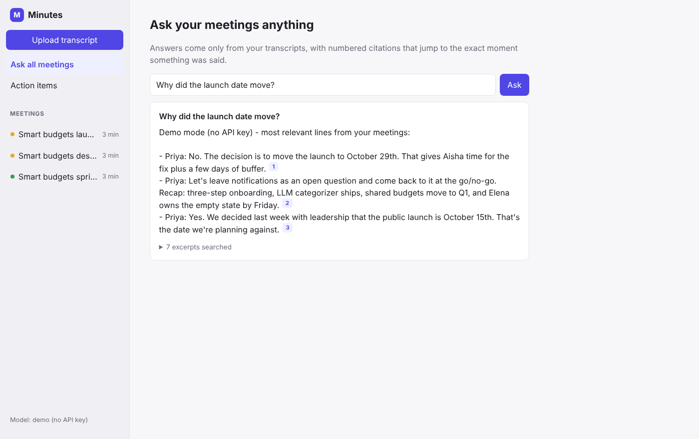
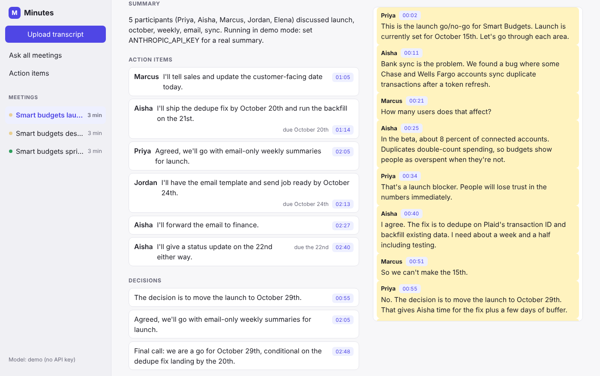
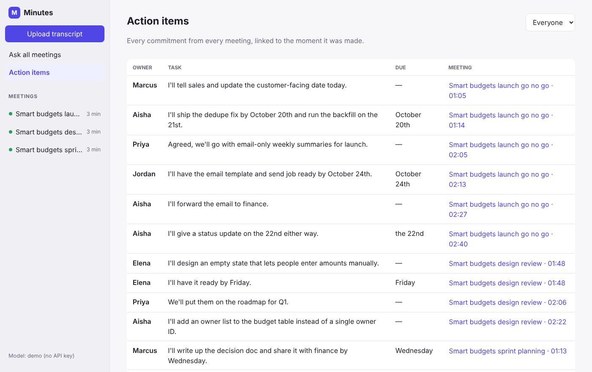
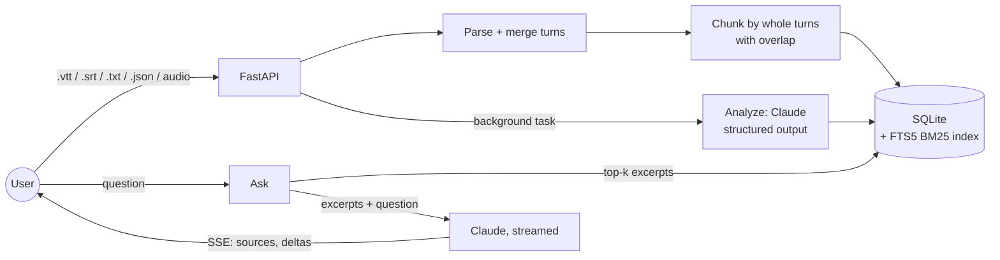

<h1 align="center">Minutes</h1>

<p align="center"><b>An AI meeting copilot: drop in a transcript, get notes you can act on, then ask questions across every meeting with answers that cite the exact moment something was said.</b></p>

<p align="center">
  Python · FastAPI · SQLite FTS5 · Claude API · React + TypeScript · Docker · GitHub Actions
</p>

---



## What it does

- **Meeting notes in seconds.** Upload a Zoom, Google Meet or Teams transcript (`.vtt`, `.srt`, `.txt`, `.json`) or an audio file. Minutes writes a summary, decisions, action items with owners and due dates, open questions and a topic outline.
- **Every item links back to the transcript.** Click a timestamp to jump to the moment it was said. Nothing in the notes is unverifiable.
- **Ask questions across all your meetings.** *"Why did the launch date move?"* returns a short answer with numbered citations. Clicking a citation opens that meeting with the cited passage highlighted. Answers stream in as they're written.
- **One action-item tracker for everything.** Every commitment from every meeting in one table, filterable by owner.
- **Export notes as Markdown** for a doc, a wiki or a ticket.
- **Runs without an API key.** In demo mode a small rule-based engine stands in for the model, so you can try the whole app (and CI can test it) for free.

| Meeting notes linked to the transcript | Action items across meetings |
|---|---|
|  |  |

<sub>Screenshots are from demo mode, using the bundled sample meetings.</sub>

## How it works



1. **Parse.** Caption exports split sentences across many short cues. Minutes normalizes VTT/SRT/text/JSON into timed segments, then merges consecutive cues from the same speaker into turns.
2. **Index.** Turns are packed into ~160-word chunks that never split a turn and overlap by one turn, so a question and its answer stay together. Chunks go into an SQLite FTS5 index (BM25 ranking, Porter stemming).
3. **Analyze.** The full transcript goes to Claude with numbered segments: `[#12 03:45] Aisha: ...`. The response is parsed straight into a Pydantic schema (`MeetingAnalysis`). The model cites **segment numbers, not clock times**: it copies an integer it can see, the server maps it to an exact timestamp, and out-of-range numbers are clamped. Timestamps can't drift or be made up.
4. **Ask.** The question is turned into a safe FTS5 query, the top excerpts are wrapped in `<source id="S1" meeting="..." time="...">` tags, and Claude answers only from them, citing `[S1]`. The answer streams to the browser over server-sent events.

More detail and the trade-offs behind each choice are in [docs/architecture.md](docs/architecture.md).

## Retrieval quality

`backend/evals` holds 20 questions about the three sample meetings. Each has the meeting and the exact phrase that answers it. A hit means the excerpt comes from the right meeting **and** contains that phrase. The eval runs in under a second, offline, in CI.

| Chunk size (words) | hit@1 | hit@3 | MRR |
|---|---|---|---|
| 60 | 0.75 | 1.00 | 0.87 |
| 100 | 0.65 | 1.00 | 0.82 |
| **160 (default)** | **0.75** | **1.00** | **0.87** |
| 250 | 0.85 | 1.00 | 0.93 |

The answer step sees the top 8 excerpts, so hit@3 is the number that matters. Larger chunks score higher on hit@1, but each citation then points at a longer passage. 160 words keeps citations to about a minute of conversation.

```bash
cd backend && python -m evals.run_retrieval_eval --chunk-words 160
```

## Quick start

### Docker

```bash
cp .env.example .env          # optional: add ANTHROPIC_API_KEY, or leave it empty for demo mode
docker compose up --build
```

Open http://localhost:8080 and click **Load sample meetings**.

### Local development

```bash
# Backend (Python 3.11+)
cd backend
python -m venv .venv && source .venv/bin/activate
pip install -e ".[dev]"            # add ",audio" to transcribe audio files locally
export ANTHROPIC_API_KEY=...       # optional
uvicorn minutes.api:create_app --factory --reload

# Frontend (Node 20+), in a second terminal
cd frontend
npm install
npm run dev                        # http://localhost:5173, proxies /api to :8000
```

### Configuration

| Variable | Default | |
|---|---|---|
| `ANTHROPIC_API_KEY` | – | Without it, Minutes runs in demo mode |
| `MINUTES_MODEL` | `claude-opus-5-5` | Model used for analysis and answers |
| `MINUTES_DEMO_MODE` | `auto` | `true` / `false` to force a mode |
| `MINUTES_DB_PATH` | `data/minutes.db` | SQLite file |
| `MINUTES_CHUNK_WORDS` | `160` | Retrieval chunk size |
| `MINUTES_RETRIEVAL_K` | `8` | Excerpts given to the model per question |

## API

| Method | Path | |
|---|---|---|
| `POST` | `/api/meetings` | Upload a transcript or audio file (multipart). Analysis runs in the background |
| `GET` | `/api/meetings` | List meetings with status (`processing`, `ready`, `failed`) |
| `GET` | `/api/meetings/{id}` | Meeting, analysis and transcript segments |
| `GET` | `/api/meetings/{id}/notes.md` | Notes as Markdown |
| `POST` | `/api/meetings/{id}/analyze` | Re-run the analysis |
| `DELETE` | `/api/meetings/{id}` | Delete a meeting and its index entries |
| `GET` | `/api/action-items` | Action items from every meeting |
| `GET` | `/api/search?q=` | Raw BM25 search over excerpts |
| `POST` | `/api/ask` | `{question, meeting_id?}` → SSE stream: `sources`, `delta`…, `done` |
| `POST` | `/api/samples` | Load the bundled sample meetings |

Interactive docs are at `http://localhost:8000/docs`.

## Testing

```bash
cd backend && pytest -q        # 40 tests, no network or API key needed
cd frontend && npm test        # citation parsing, SSE parsing, formatting
```

The Claude integration is tested against a fake client. The tests check the exact request (model, structured-output schema, refusal fallback, prompt rendering), and that refusals and truncated responses become clear errors instead of half-saved notes. CI runs lint, both test suites, the retrieval eval and a Docker build on every push.

## Project layout

```
backend/
  minutes/
    transcript.py   VTT/SRT/TXT/JSON parsing, turn merging
    chunking.py     turn-aligned overlapping chunks
    store.py        SQLite schema, FTS5 index, BM25 search
    schemas.py      MeetingAnalysis (structured output)
    prompts.py      system prompts and transcript/source rendering
    llm.py          Claude backend + demo backend
    service.py      ingest pipeline, Markdown export
    api.py          FastAPI app
    transcribe.py   optional local speech-to-text (faster-whisper)
  evals/            retrieval eval set and runner
  tests/
frontend/src/       React + TypeScript UI
samples/            three fictional meetings used by demo mode and the evals
```

## Roadmap

- Speaker diarization for audio uploads
- Hybrid retrieval (BM25 + embeddings) once the eval set includes paraphrased questions where keyword search misses
- An answer-quality eval graded against the sample meetings
- Calendar and Zoom/Meet integrations to import transcripts automatically

## License

MIT
